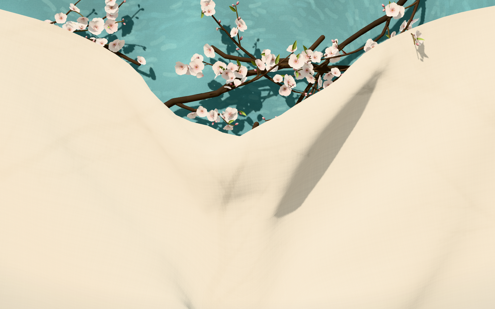

# 杏花布袋 · Almond Pouch

The whole page is a sheet of backlit linen with the faint shadow of a tree behind it. Pull it down anywhere and the hem opens into a V, the turquoise sky appears, and the shadows turn into almond blossoms that unfurl as the hem passes them. Colours after Van Gogh's *Almond Blossom* (1890).

**Live:** [tearable-almond-blossom.vercel.app](https://tearable-almond-blossom.vercel.app)



## Run

```bash
npm install
npm run dev      # http://localhost:5188
npm run build    # static site in dist/
```

## How it works

- **Curtain** — a full-page Verlet cloth hung from sliding clips. Near your hand the clips follow the pull, so the hem forms a V that widens as it deepens. The clips keep part of every dip, so after the cloth springs back, the shape you pulled stays.
- **Backlight** — each frame the tree is drawn in black into a small mipmapped render target. The linen shader samples it in screen space, so the branches show through the weave as soft shadows.
- **Tree** — procedural almond limbs, branches and twigs. Covered twigs are pressed flat. When the hem passes, a spring releases them with a little overshoot, and each flower unfurls after a short random delay. A fast pull opens everything at once.
- **Flowers** — five cupped petals per flower, plus stamens, buds and young leaves. Everything is instanced geometry with canvas-generated textures; there are no image assets.
- **Occlusion** — what is visible is decided in screen space. Hanging twigs can flop over the hem only where it has been pulled down. Falling petals land on the linen and move with it.

Mouse and touch both work. On phones it uses a lighter cloth grid, adaptive resolution, and pauses when the tab is hidden.
