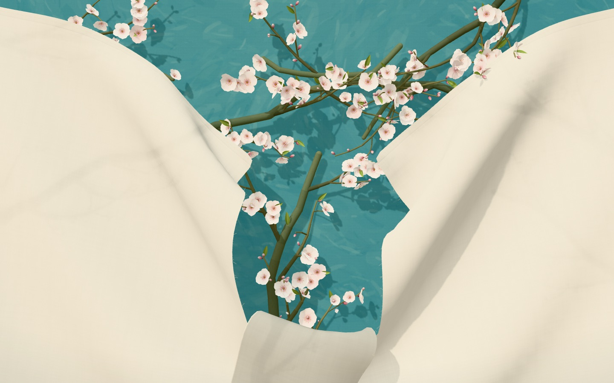
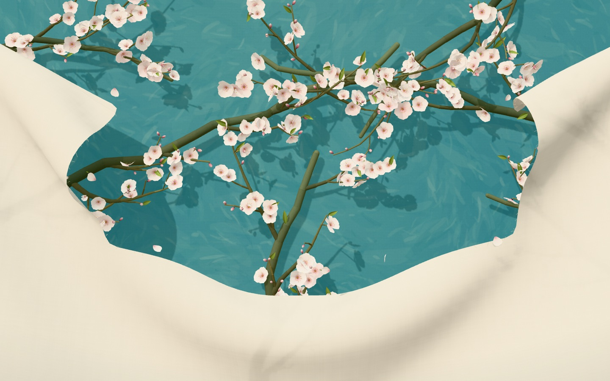
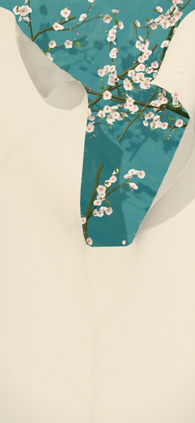

# 杏花布帘 · Tearable Almond Blossom

The whole page is a sheet of backlit linen, with the faint shadow of an almond tree showing through the weave. Pull it and the hem gives way into a V, turquoise sky appears, and the shadows become blossoms that unfurl as the edge passes them. Pull harder and the linen tears. Colours after Van Gogh's *Almond Blossom* (1890).

整页是一块逆光的亚麻帘，布上透出杏树的影子。往下拉，布边陷成 V 口，影子变成一朵朵旋开的杏花；再用力，亚麻就被撕开。

**Live:** [tearable-almond-blossom.vercel.app](https://tearable-almond-blossom.vercel.app)



| Repeated tears | Phone |
|---|---|
|  |  |

## Try it

Pull slowly to gather the linen. Keep pulling down to tear it, then tug sideways to tear the flap off. Let go and it settles. Refresh to start over.

## Run

```bash
npm install
npm run dev              # http://localhost:5188
npm run build            # static site in dist/
npm run build:minitool   # sandboxed mini-tool package (needs the platform's packaging skill locally)
```

## How it works

- **Curtain**: a full-page Verlet cloth hung from sliding clips. A gentle pull gathers the hem into a V, and the curtain keeps the shape after you let go.
- **Tearing**: the mesh topology really splits. Vertices along the cut are duplicated, crossing constraints are dropped, and triangles and the occlusion height field update in the same step. Torn edges grow loose fibres, and detached scraps fall away.
- **Smooth surface**: the physics mesh is subdivided once into a display surface. Torn flaps and the curtain are kept from passing through each other on both meshes.
- **Backlight**: each frame the tree is drawn into a small render target, which the linen shader samples so the branches show through as soft shadows.
- **Tree and blossoms**: procedural almond limbs, twigs, buds and five-petal blossoms, all instanced geometry with canvas-generated textures. There are no image assets. Twigs that were pressed flat spring free when revealed, and each flower opens after a short random delay.

Mouse and touch both work. Phones get a lighter cloth grid and adaptive resolution, and the page pauses when hidden.

More: [development log](docs/DEVLOG.md) · [references](docs/references.md)

## License

MIT
